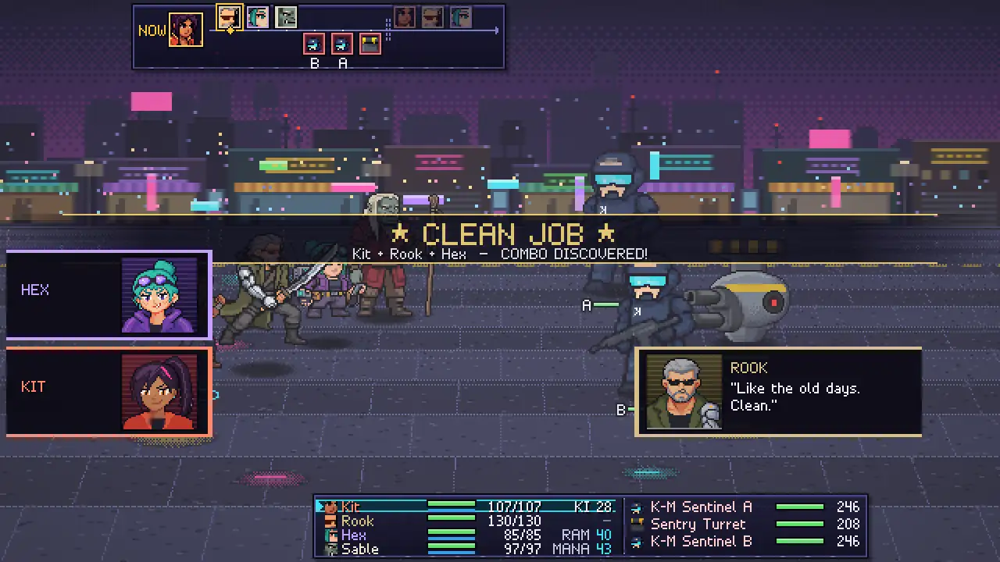
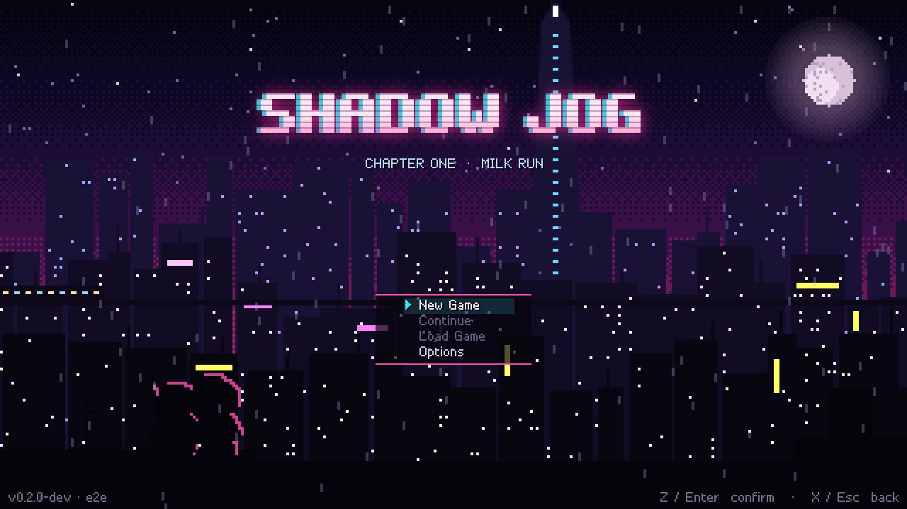
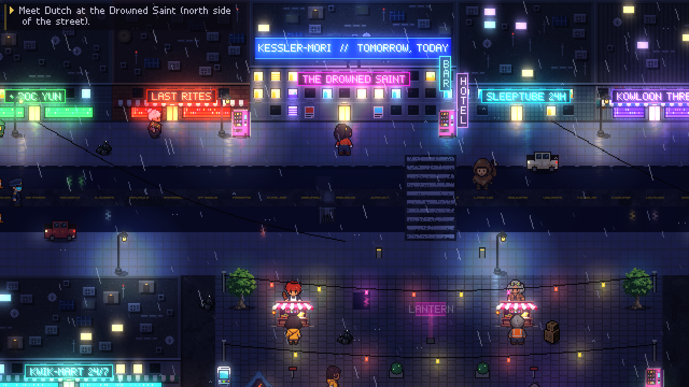
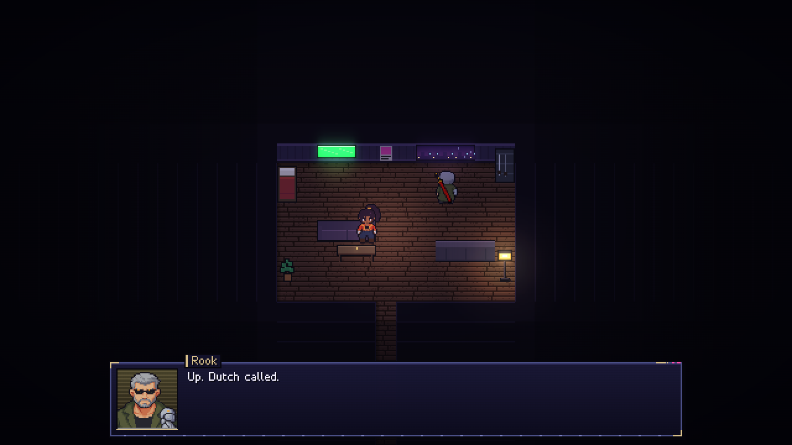
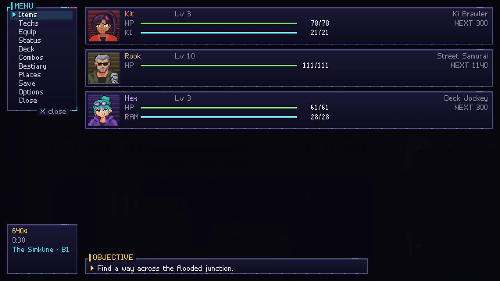
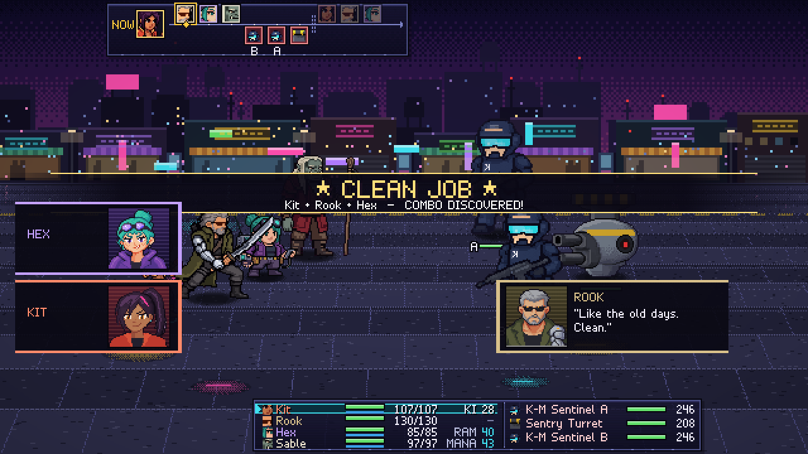
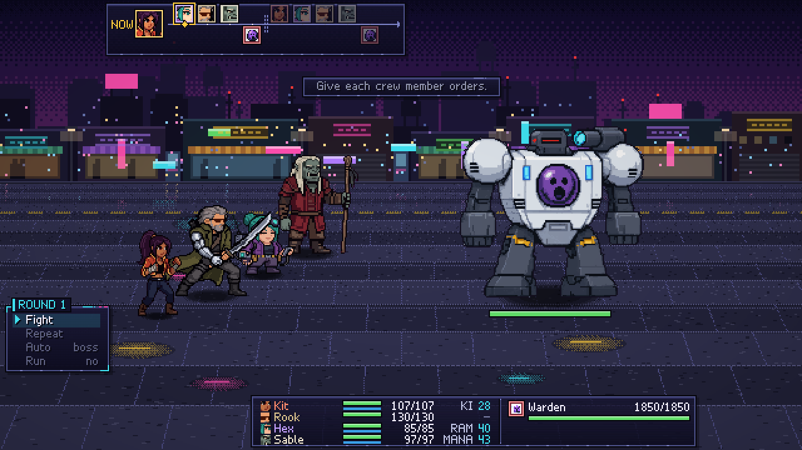
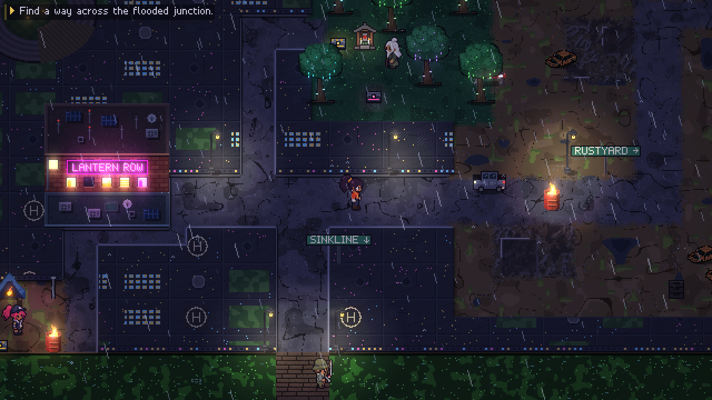
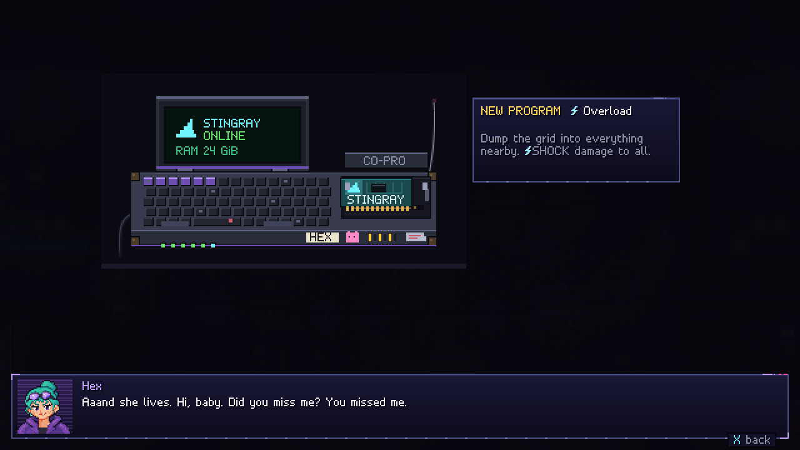
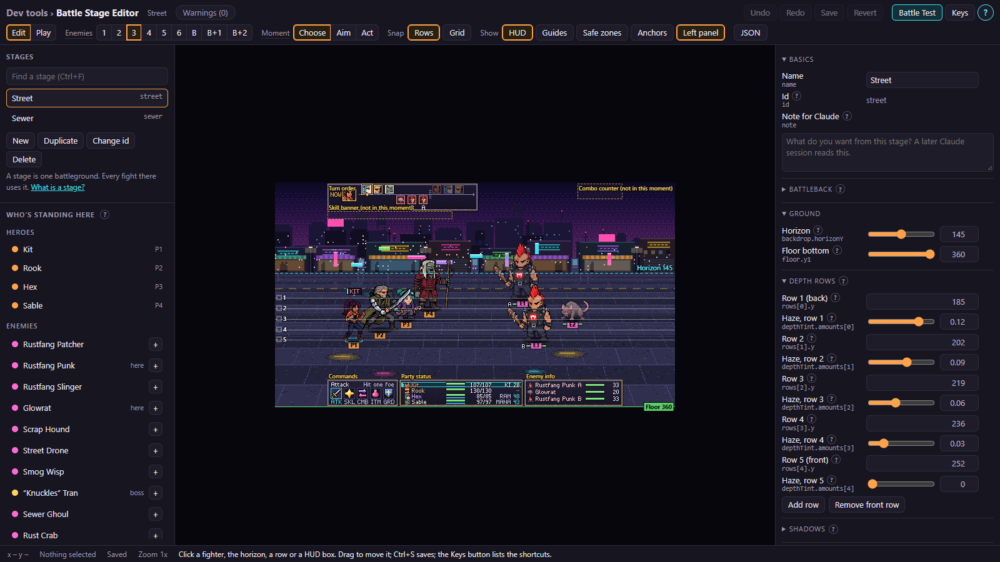

<div align="center">

# SHADOW JOG

**A cyberpunk-fantasy JRPG that runs in your browser.**
Four runners, one "simple" job, and a drowned city that does not forgive mistakes.

[](https://github.com/markhazlewood42/shadow-jog/actions/workflows/ci.yml)




</div>

## What it is

- A 16-bit-style JRPG set in **Saltreach**, a drowned coastal megacity in 2079. Magic meets megacorp: street samurai, deck jockeys, shamans.
- The loop comes from *Phantasy Star IV*: town, world map, dungeon, boss. A four-person crew, round-based battles, and combination attacks.
- **Chapter 1, "Milk Run"**, is playable start to finish: about 45 to 75 minutes.
- It runs in a desktop browser. There is no public deploy yet, so you build it locally (below).

## Screenshots

| | | |
|:--:|:--:|:--:|
|  |  |  |
| Title screen | Lantern Row, in the rain | Dialog with portraits |
|  |  |  |
| Party menu | A combo is discovered | Boss: the Warden |
|  |  |  |
| World map: the Sprawl | Hex's deck boots | Battle Stage Editor |

## What works today

- **Combat with combos.** Round-based battles with techniques, skills, items and weaknesses by enemy family. Pick the right pair of crew actions in one round and they fuse into a named combo.
- **Its own engine.** PixiJS v8 for 2D and Three.js for 3D, at 640x360 with whole-pixel scaling. The move to this engine finished on 2026-10-16.
- **Audio made in code.** The music and sound effects are generated at runtime.
- **Editor tools** for the people who make the game: a Battle Stage Editor, an Animation editor, an FX lab and an Art review page.
- **Quality of life.** Save anywhere on the field, autosave, retry a lost battle, dash, rebindable keys.

## Play it locally

You need Node.js 24 and npm.

```bash
npm install
npm run dev        # http://localhost:3007
```

Run the shipped build instead with `npm run build && npm run preview` (http://localhost:3008). `npm run check` runs lint, type checks and unit tests.

| Action | Keyboard | Gamepad |
|---|---|---|
| Move | Arrows / WASD | D-pad / left stick |
| Confirm / talk | Z, Enter, Space | A / Cross |
| Cancel | X, Esc, Backspace | B / Circle |
| Menu | C, Tab | Y / Triangle, Start |
| Dash (hold) | Shift | X / Square, RB, RT |
| Fullscreen | F | |

Keys are rebindable in Options, Controls.

## Where it is going

Chapter 1 is the alpha. Four epics lead to a demo that others can play:

| Epic | What it is |
|---|---|
| [2D art and maps](https://github.com/markhazlewood42/shadow-jog/issues/102) | A consistent art style, a tileset format and map tools |
| [3D hacking mode](https://github.com/markhazlewood42/shadow-jog/issues/103) | A real-time 3D hacking mode inside the 2D game |
| [Editor suite](https://github.com/markhazlewood42/shadow-jog/issues/104) | Dialogue, map and event editors |
| [Engine docs](https://github.com/markhazlewood42/shadow-jog/issues/105) | The engine, explained for people who learn from it |

The demo needs the 2D art and the 3D hacking mode, after Mark plays through Chapter 1 end to end. See the [roadmap picture](docs/roadmap/roadmap.svg) and [the roadmap table](docs/roadmap/README.md). Work tracking lives in a GitHub project and in the issues.

## For developers

| Read | For |
|---|---|
| [`docs/ARCHITECTURE.md`](docs/ARCHITECTURE.md) | How the code fits together |
| [`docs/DEVELOPING.md`](docs/DEVELOPING.md) | Commands, tests, debug tools, conventions |
| [`docs/GDD.md`](docs/GDD.md) | The game design |
| [`docs/CONCEPTS.md`](docs/CONCEPTS.md) | The game-dev and JRPG ideas behind it, in plain words |
| [`docs/engine/`](docs/engine/) | The engine design: scene graph, rendering, interfaces |
| [`status.md`](status.md) | Where the project stands now |

`npm run dev` prints the dev tools. Press the backtick key in the game for the DEV tab. `npm run cc` starts the Command Center (status, docs and decisions) on http://localhost:3009. CI runs lint, types, unit tests and the full Playwright suite on every pull request.

## Credits

- **Design and direction:** Mark Hazlewood.
- **Built with [Claude Code](https://claude.com/claude-code).** The code is written by AI agents under Mark's direction, and independent verifier agents check each build.
- **Art:** the characters are drawn in code. Many tiles and props are AI-generated picks from an earlier PixelLab art pass. The crew idle sheets come from Sprite Fusion, whose terms allow use in a distributed game. New 2D art comes from Sprite Fusion or other sources.
- **Music and sound:** generated in code.
- **Built on:** [PixiJS](https://pixijs.com), [Three.js](https://threejs.org), [Vite](https://vitejs.dev) and [Playwright](https://playwright.dev).
- The setting borrows the feel of the genre. Every name, place and term is original.

This repository has no license file yet, so all rights are reserved until one is added. You can still read the code and fork it on GitHub.
