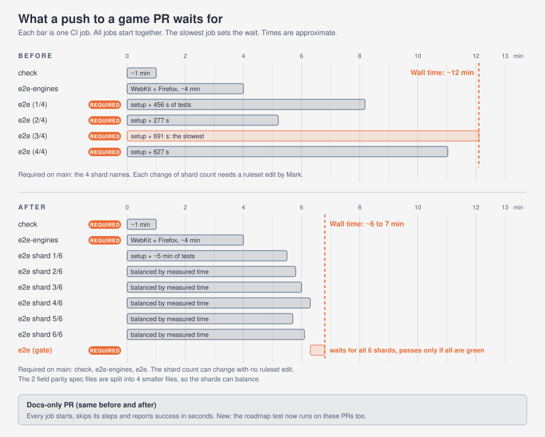

# CI strategy

This is the full picture of CI for Shadow Jog. The workflow is `.github/workflows/ci.yml`. The playtest has its own workflow, `.github/workflows/playtest.yml`.



## What runs, and when

| Event | What happens |
|---|---|
| Pull request, game or code change | `check`, six e2e shards, the `e2e` gate and `e2e-engines` all run. A new push cancels the earlier run of the same pull request |
| Pull request, docs-only change | Every job still starts and reports. `check` runs only the roadmap test. The shards and `e2e-engines` skip their steps |
| Push to `main` | The same jobs run, unless the push changes only docs, notes, `tools/command-center/` or the Claude review workflow. A run on `main` is never canceled once it starts |
| Push to `main` (playtest) | `playtest.yml` runs the real-speed playtest. It does not run on pull requests |
| Manual run | Actions tab, CI, **Run workflow**. A manual run is always a full run |

"Docs-only" means that every changed file is under `docs/` or `tools/command-center/`, is a `*.md` file, or is `.github/workflows/claude-code-review.yml`. If git cannot list the changed files, the jobs run in full. The check fails closed.

## The jobs

| Job | Check name | What it does | Time of tests |
|---|---|---|---|
| `check` | `check` | Lint, typecheck, unit tests (Vitest), the bundle budget | a few minutes |
| `e2e-shards` | `e2e (1/6)` to `e2e (6/6)` | The Playwright specs on Chromium, one spec list per shard | about 5 to 6 minutes each |
| `e2e` | `e2e` | The gate. It passes only when every shard passed | about 5 seconds |
| `e2e-engines` | `e2e-engines` | `gameover` and `prod` on WebKit (the whole flow) and Firefox (the "no WebGL 2" message) | about 3.5 minutes |

All jobs start together. The `e2e` gate is the only job that waits, and it waits only for the shards. A pull request waits for the slowest shard, about 6 to 7 minutes with the setup. Before this change it waited about 12 minutes.

The repo is public, so GitHub-hosted runner minutes cost nothing. More shards cost no money.

## The six shards

The specs are split by name, not with Playwright's `--shard`. `--shard` splits by test count, and the tests differ a lot in cost (a field parity state takes about 24 seconds, a chaos test about 10). The lists are balanced by measured time.

The seconds below come from the green runs `38150548004` and `38156248801` (one worker, the `list` reporter). The four field parity files are estimates: they were split from the old `a` (365 s) and `b` (230 s) files by test count, and they have no run of their own yet. Replace the estimates with the first real numbers.

| Shard | Specs | Seconds |
|---|---|---|
| `e2e (1/6)` | `default-path` 283, `sje-fx` 41, `fxlab` 12 | 336 |
| `e2e (2/6)` | `sje-field-parity-a` about 195, `playthrough` 150 | 345 |
| `e2e (3/6)` | `sje-field-parity-b` about 170, `sje-battle` 145, `gpufx` 39 | 354 |
| `e2e (4/6)` | `sje-field-parity-c` about 150, `gameover` 141, `sje-canaries` 47 | 338 |
| `e2e (5/6)` | `sje-field-parity-d` about 80, `prod` 117, `sje-field` 117 | 314 |
| `e2e (6/6)` | `sje-draws` 113, `economy` 99, `sje-stage-parity` 59, `chaos` 50, `sje-shell` 43 | 364 |

Each shard has about 30 seconds of setup (checkout, `npm ci`, the Chromium download) and about 5 seconds for the server start. The cap is 30 minutes for each shard.

The field parity set is four files. Playwright names a test by the file that calls `test()`, so one file cannot be split across shards. The test bodies live in `e2e/sjefieldparityparts.ts`.

| File | Holds |
|---|---|
| `sje-field-parity-a` | The inputs check, and states 0 to 7 (the town street and the world map, with their variants) |
| `sje-field-parity-b` | States 8 to 14 (the world map by day, the yard, the sinkline, the annex, the dock) |
| `sje-field-parity-c` | States 15 to 30 (the interiors, and the GPU-only states, which skip themselves on CI) |
| `sje-field-parity-d` | The 6 controls (each must fail the bounds) |

### Specs that CI does not run

These are on the `NOT_IN_CI` list in `tests/ci-shards.test.ts`, each with its reason.

| Spec | Why |
|---|---|
| `perf` | Frame timing needs a real GPU. Run `npm run perf` locally |
| `sje-bench` | Times a GPU with 1,000 objects. Local only |
| `shots` | Regenerates `docs/screenshots/`. It makes pictures and judges nothing |
| `audio-evidence` | Writes reports under `docs/quality/evidence/audio/`. It makes files and judges nothing |
| `playtest` | The real-speed playtest. It has its own workflow, `playtest.yml` |
| `sje-pictures` | The pictures for the M3 look review. Local only |
| `sje-scene3d` | Unclear. It was never in a CI list, and its header says it can run on SwiftShader "like CI". It may belong in a shard. Decide, then move it |

## The `e2e` gate, and the required checks

The `main` ruleset requires three checks: `check`, `e2e-engines` and `e2e`.

The shard names (`e2e (1/6)`) are not required. A required check that never reports blocks the merge for ever, so a ruleset that lists shard names breaks whenever the shard count changes. The `e2e` gate has one stable name. It `needs` the shard job and runs with `if: always()`. It fails unless the shard result is `success`. A failed, cancelled or skipped shard makes the gate fail.

`if: always()` matters. Without it, a failed shard would skip the gate, and a skipped job reports success.

The job id of the shard matrix is `e2e-shards`, so the gate can have the id and name `e2e`. Do not rename the jobs `check`, `e2e` or `e2e-engines`: the ruleset matches the names.

## The docs-only skip

Every job has the same first step, "Check which files changed". It compares the pull request with its base. If every changed file is a docs file, the later steps skip. The job itself never skips, because a skipped job reports success without checking anything. Each job has its own copy of the step, on purpose: one shared detection job could fail, and a required check must not depend on it.

On a docs-only pull request, `check` still runs `tests/roadmap.test.ts`. That test reads `docs/engine/migration.md` and `docs/roadmap/*`, so the skip must not hide drift there. It costs `npm ci` and one Vitest file.

## Add a new spec

1. Write `e2e/<name>.spec.ts`.
2. Add it to the shard with the smallest total in `ci.yml` (matrix `specs`). Or add it to `NOT_IN_CI` in `tests/ci-shards.test.ts`, with a reason.
3. Run `npx vitest run tests/ci-shards.test.ts`.

The test fails if a spec is in no shard and not on `NOT_IN_CI`, if a spec is in two shards, or if a listed file does not exist. It has negative controls, so it can fail.

## Rebalance the shards

1. Open a recent green run on `main`. Read the `list` reporter lines of each shard. Each line ends with the test time.
2. Add up the seconds for each spec file.
3. Move specs between the lists in `ci.yml` until no shard is over about 6 minutes of tests.
4. Update the comment above the matrix with the new totals and the run id.
5. Run `tests/ci-shards.test.ts`. No ruleset change is needed, because the gate is the only required shard check.

To split a spec file that is the floor, share its test bodies in a helper (like `sjefieldparityparts.ts`) and write more spec files. Do not change what a test checks.

## Force a full run

- On a pull request, push a change to any file that is not a docs file. Or push a commit that touches one `src/` or `e2e/` file.
- By hand: Actions tab, CI, **Run workflow**, pick the branch. The scope step runs only on a pull request, so a manual run is always full.

## Run one shard on your machine

```bash
CI=1 PW_PORT=3012 npx playwright test --project=chromium <the specs of one matrix entry in ci.yml>
```

## Experiments next

These are not built. Each is a throwaway draft pull request that is closed after, never merged. The numbers go to Mark before any build.

### L3. A test build instead of the dev server

Every boot loads hundreds of unbundled modules from the Vite dev server, with software WebGL. A test build (`vite build --mode e2e`, with the `window.__SJ__` hooks on) served by `vite preview` may boot much faster.

- Measure: one CI run times 5 boots on the dev server against 5 boots on a test build.
- Adoption line: adopt only if a boot is at least 30% faster.
- Risk: the hooks must stay out of the shipped bundle. The bundle budget test and `prod.spec.ts` already check the shipped build.

### L4. Two workers per shard

`playwright.config.ts` has `workers: 1`.

- Measure: set `workers: 2` on one shard, and run it 3 times. Count flakes and compare the times.
- Adoption line: adopt only with 0 new flakes in 3 runs. Earlier slow-runner failures (Game Over, the battle golden, the playthrough) show that CPU load breaks timing-sensitive tests.
- If the six shards already reach the target, skip L4.

## Not done

- **Path selection** (run only the specs that a change can touch). Of the last 30 merged pull requests, 18 were docs-only (already skipped) and 9 touched game files (13 of 17 specs boot the whole game). The gain is small. The named spec lists make it easy to add later.
- **A Playwright browser cache.** It would save about 20 seconds per shard. Playwright advises against it, and the system packages that `--with-deps` installs cannot be cached.
- **L5: fixed waits to condition waits.** 143 `waitForTimeout` calls hold about 124 seconds of fixed delay. Replace the waits in `prod`, `gameover`, `economy` and `gpufx` (about 84 seconds) with waits on a state. Each change needs a negative control. It also removes a cause of flakes.
