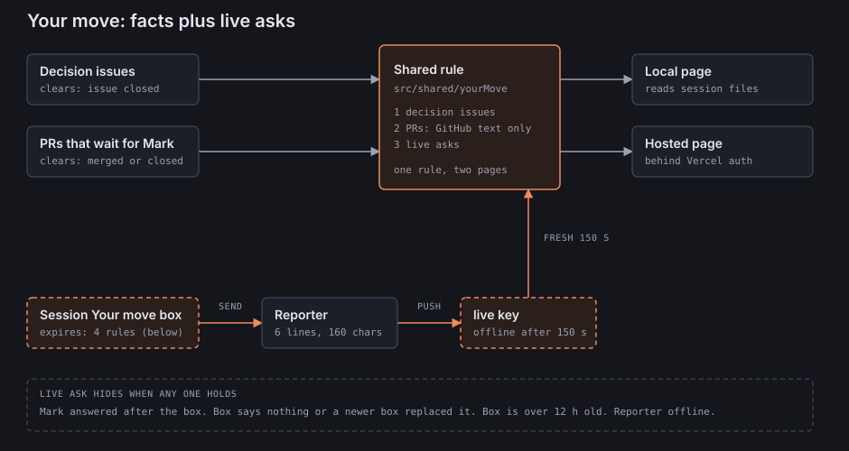

# Your move redesign: facts plus live asks

## 1. Problem

On 2026-10-13 the hosted Now page showed 16 items in "Your move". None was real. The hosted list (`tools/command-center/src/web/hosted/your-move.ts`) takes the `next_for_mark` lines of the workstream file on every remote branch. A session writes those lines and then stops. Nothing clears them after a merge or at the end of the session. Most real session boxes say "Your move: nothing".

## 2. The model

"Your move" shows only items that clear themselves. The hosted page and the local page use the same three sources and one shared rule in `tools/command-center/src/shared/`.

| Source | Shows when | Clears when |
|---|---|---|
| Decision issues | An issue is open, has the label `decision`, and `markhazlewood42` made it | The issue is closed |
| Pull requests that wait for Mark | The `attentionOf` rule: open, not draft, author Mark. Action is `merge` when checks pass and `fix` when checks fail or changes are requested | The PR is merged or closed |
| Live asks | The newest "Your move" box of a live session. One item per box line | Any one of the four rules below |

The text of a PR item comes from GitHub (number and title). It never comes from session text.

A live ask hides when any one of these holds:

1. The session is not live. The reporter must see its process, and the `live` key must be fresh. After 150 s the hosted page shows "Reporter offline" and hides all live asks.
2. Mark sent a message to the session after the box (`answered` in `src/server/sessions/parse.ts`).
3. The box says "Your move: nothing" (`SAYS_NOTHING`), or a newer box replaced it.
4. The box is more than 12 hours old.

A newer reply without a box leaves the box as it is. This matches the home-base reply rule. Each item shows the session title and the age of the box.

## 3. Diagram

## 4. Trust rule change

Today the reporter allow-list sends no message text (`tools/command-center/README.md`, "What leaves this machine", and `src/server/publish/map.ts`). Live asks need the lines of the newest open box.

The new rule:

- Per live session, send at most 6 box lines.
- Cut each line to 160 characters.
- Run each line through the same secret redaction as titles.
- Send the lines only when the box passes the four rules above.
- Send nothing else of the message.

The hosted page stays behind Vercel Authentication. The fail-closed protection check of the reporter stays as it is. The build gets an attacker verifier for this path.

### Dependency

Live asks depend on a working reporter. Mark reports open problems in the local services, the reporter included. They need their own debug session. Until the reporter works, the hosted page shows only decision issues and PRs. It shows "Reporter offline" in place of the live asks. A failed reporter must never show old asks. The order is: debug the reporter first, then build live asks.

## 5. What goes away

- `next_for_mark` leaves the workstream files, the validator (`src/shared/workstream.ts`), `tools/command-center/tests/workstream-files.test.ts`, the Workstreams cards, and "Your move". Existing files lose the field.
- `docs/workstreams/README.md` changes to match.
- The "Workstream file" bullet in the repo `CLAUDE.md` no longer says a session makes `next_for_mark` true.
- On the local page, the `status.md` "Next up for Mark" list and the open decisions of the engine docs leave "Your move". They stay on their own pages (open question A).

## 6. Tests to add or change

- Add `yourMove.test.ts` (the shared rule, one case for each clear rule).
- Change the `hosted-*` tests.
- Change `publish-map.test.ts` (the wider allow-list, the caps, the redaction).
- Change `sessions-parse.test.ts`.
- Change the `workstream*.test.ts` files.
- Change `e2e/hosted/hosted.spec.ts` and `e2e/now.spec.ts`.

## 7. Open questions for Mark

- **A.** Remove "Next up for Mark" and the engine-doc open decisions from the local "Your move"? Recommended: yes. They do not clear themselves.
- **B.** Approve the wider reporter allow-list in section 4? Recommended: yes, with the attacker verifier.

## 8. Not built yet

No code changed. This note is a draft. It proposes to replace section 5.1 of `design.md` (the "Your move" part) after Mark approves it.
