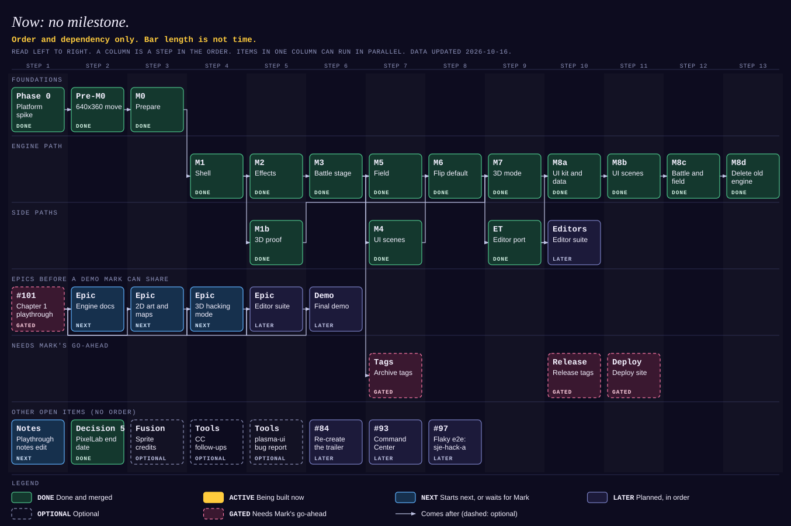

<!-- Generated by scripts/gen-roadmap.mjs from docs/roadmap/roadmap.json. Do not edit by hand. Run `npm run roadmap`. -->

# Shadow Jog roadmap

Now: no milestone.

**Order and dependency only. Bar length is not time.** Mark wants no hour or day estimates. A column is a step in the order. Items in the same column can run in parallel.

*Source: [roadmap.json](roadmap.json). The chart is [roadmap.svg](roadmap.svg).*

## The same data as a table

| Item | Lane | Step | Status | Comes after | Where | Notes |
|---|---|---|---|---|---|---|
| Phase 0 Platform spike | Foundations | 1 | done | none | PR #11 (draft, never merged) | Mark approved the final engine design on 2026-10-05. Record: docs/spikes/engine-platform.md. |
| Pre-M0 640x360 move | Foundations | 2 | done | Phase 0 | branch `resolution-640x360`, PR #23 (merged 2026-10-09) | The shipped game plays at 640x360. Record: docs/PIVOT-640.md. |
| M0 Prepare | Foundations | 3 | done | Pre-M0 | branch `engine-m0-prepare`, PR #43 (merged 2026-10-09) | Size module, bundle gate, canary suite, lab, agent docs. CI runs no timing gate; perf is local (npm run perf). |
| M1 Shell | Engine path | 4 | done | M0 | branch `engine-m1-shell` | Loop, renderer, scene stack, LegacyScene adapter. Behind the ?engine=sje flag. Merged in PR #46; GPU line held. |
| M2 Effects | Engine path | 5 | done | M1 | branch `engine-m2-effects` | FxSystem with the postfx facade, composite filter, particles. GPU timing check (npm run perf) once at the end, not in CI. Built on branch engine-m2-effects; GPU line held (2026-10-09). |
| M3 Battle stage | Engine path | 6 | done | M2 | branch `engine-m3-battle-stage`, PR #51 (merged 2026-10-10) | The side-battle rebuild landed here. Spike PRs #3 (side-battle) and #4 (phaser-stage) stay open as references and never merge. GPU timing check (npm run perf) done once at the end on an RTX 4070 (2026-10-10): live battle interval p95 18.10 ms against bare 18.10, cost p95 3.40 ms; the speed line held. |
| M5 Field | Engine path | 7 | done | M3 | none | Field map, actors, camera, lights, weather. Mark approves the lighting. GPU timing check (npm run perf) once at the end, not in CI. |
| M6 Flip default | Engine path | 8 | done | M5, M4 | branch `engine-m6-flip`, PR #58 (merged 2026-10-11) | ?engine=sje becomes the default. The old presenter goes. M4 joins here if it is built. It is optional (dashed arrow). GPU timing check (npm run perf) once at the end, not in CI. |
| M7 3D mode | Engine path | 9 | done | M6, M1b | branch `engine-m7-3d-mode`, PR #80 (merged 2026-10-13), review fixes #82 (merged 2026-10-13) | Needs both the 3D proof (M1b) and the default flip (M6). GPU timing check (npm run perf) once at the end, not in CI. |
| M8a UI kit and data | Engine path | 10 | done | M7, ET | branch `engine-m8a-ui-kit`, PR #94 (merged 2026-10-14) | Merged 2026-10-14 (PR #94). The UI kit is in src/sje/ui (TextObject, NineSlice, ListMenu, bar, cursor), and the shop and dialogue content moved to data files. Mark ran the GPU timing check (npm run perf) on 2026-10-14: it passed. Record: docs/engine/m8-brief.md. |
| M8b UI scenes | Engine path | 11 | done | M8a | none | Port the 13 UI scenes to native scenes, small to big. All 13 are native. Merged in PR #95 (2026-10-15). Follows the diff rule for the GPU timing check. |
| M8c Battle and field | Engine path | 12 | done | M8b | none | Port the battle and field scenes. Merged in PR #96 (2026-10-15). |
| M8d Delete old engine | Engine path | 13 | done | M8c | none | Delete the old engine, LegacyScene and the exemptions. Move the kept src/engine files into src/sje. Docs and the PR #86 follow-ups. Merged in PR #98 (6bf70cf, 2026-10-16); the old engine and src/engine are gone. GPU timing check passed. |
| M1b 3D proof | Side paths | 5 | done | M1 | none | Parallel with M2. A spinning cube in a Scene3D, with the hand-off, leak and loss tests. |
| M4 UI scenes | Side paths | 7 | done | M3 | none | Closed 2026-10-16 (Mark). M8b and M8c ported all 13 UI scenes and the battle and field scenes to native sje scenes, so nothing is left to port. |
| ET Editor port | Side paths | 9 | done | M6 | branch `engine-et-editor-port`, PR #86 (merged 2026-10-14) | Merged 2026-10-14 (PR #86), before M8. Every editor and tool moved to the new engine; the Battle Stage Editor (/stageedit.html) and Battle Test are back. The trailer is deleted (#84). Two exceptions until M8d: the Battle Test glue module and the shared old Input. Record: docs/engine/et-brief.md. |
| Editors Editor suite | Side paths | 10 | later | ET | none | After Chapter 1. New UI editors so Mark builds the game mostly in tools: troops, database, maps, conversations, animation composer, lights and weather. Plan: docs/TOOLING-UI.md section 4. |
| E1 2D art and maps | Epics before a demo Mark can share | 1 | next | none | none | Redo all 2D assets in the Sprite Fusion style, with one quality bar across 2D mode. Find or make a real tileset for maps at two scales (in-town and overworld), learning heavily from RPG Maker. Ends with a full game walkthrough with Mark's notes. |
| E2 3D hacking mode | Epics before a demo Mark can share | 2 | next | none | none | Design a first draft of hacking in 3D mode: find or make 3D assets, build the gameplay (Mark has notes on visuals and gameplay), and add at least one hacking mission to the Chapter 1 story. |
| E3 Editor suite | Epics before a demo Mark can share | 3 | next | none | none | An RPG Maker-like editor suite. First review and improve every existing tool and editor for use and clarity (a clear purpose and workflow each). Then add tools to build more chapters. Builds on the Editors milestone. |
| E4 Engine docs | Epics before a demo Mark can share | 4 | next | none | none | Side project. Document and diagram the engine architecture, add code comments so Mark can read the code, and simplify the docs. |
| archive-tags Archive tags | Needs Mark's go-ahead | 7 | gated | M3 | none | archive/side-battle-<date> and archive/phaser-stage-<date>, then close PRs #3 and #4. Mark approves each tag. They wait until M3 lands (status.md, Next for agents 3). |
| release-tags Release tags | Needs Mark's go-ahead | 10 | gated | none | none | Annotated v* tags. Cut only after Mark's playtest and go-ahead. Not tied to one milestone. The column is only a place on the chart. |
| deploy Deploy site | Needs Mark's go-ahead | 11 | gated | none | none | Site: shadowjog.com. The last alpha step, with the secure email sign-up. Only with Mark's explicit go-ahead. Not tied to one milestone. The column is only a place on the chart. |
| playthrough-notes Playthrough notes edit | Other open items (no order) | 1 | next | none | none | Mark's uncommitted edit to docs/mark-playthrough-notes.md waits for him. |
| pixellab-end PixelLab end date | Other open items (no order) | 2 | done | none | none | Decided 2026-10-16 (Mark): PixelLab is out. New 2D art comes from Sprite Fusion or other sources. |
| sprite-fusion Sprite credits | Other open items (no order) | 3 | optional | none | none | Sprite Fusion is now the main art source (PixelLab is out, 2026-10-16). Credits go to the art epic E1. |
| cc-followups CC follow-ups | Other open items (no order) | 4 | optional | none | none | Command Center items left over (status.md, Next for agents 1b). All optional. |
| plasma-bug plasma-ui bug report | Other open items (no order) | 5 | optional | none | none | An upstream bug report for the plasma-ui canvas width (R28), if Mark wants one. |

Statuses: **done** (done and merged), **active** (being built now), **next** (starts next, or waits for mark), **later** (planned, in order), **optional** (optional), **gated** (needs mark's go-ahead).

## How to update

1. Edit `docs/roadmap/roadmap.json`. It is the only source. Never edit `roadmap.svg` or this file by hand.
2. Run `npm run roadmap`. It rewrites `roadmap.svg` and this file.
3. Run `npm run check`. The test `tests/roadmap.test.ts` fails when the generated files are out of date.

Do this in every status update. A milestone item uses the same id as its row in the table of `docs/engine/migration.md` section 2 (`M0`, `M1b`, `Pre-M0`). The `milestone:` key in the frontmatter of `status.md` must name the milestone item whose status is `active`. The value `none` means no item is active. `Pre-M0` may also be `done`.

Item fields:

| Field | Meaning |
|---|---|
| `id` | A unique name. A milestone uses its id from `migration.md`. |
| `kind` | `milestone` for a row of that table. Leave it out for anything else. |
| `label` | The name on the bar: two lines of 12 characters at most. |
| `tag` | Optional. The short first line on the bar. The default is the id. 10 characters at most. |
| `lane` | The id of a lane in `lanes`. |
| `status` | One of `done`, `active`, `next`, `later`, `optional`, `gated`. |
| `after` | The ids this item waits for. It sets the column: one after the latest one. A list can be empty. |
| `column` | Optional. Puts the item in a later column than its dependencies need. Counts from 0. |
| `branch`, `pr` | Optional. Where the work is. |
| `notes` | One or two short sentences. |
